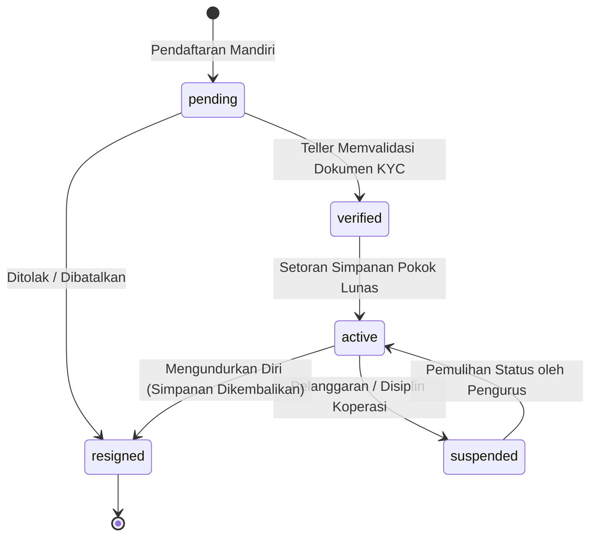
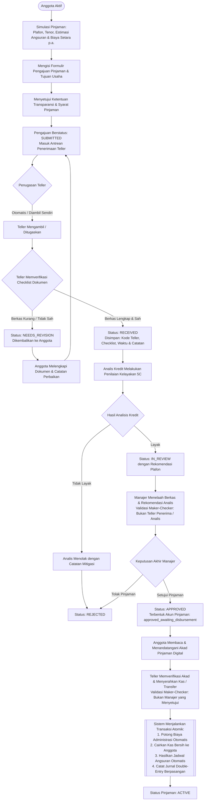
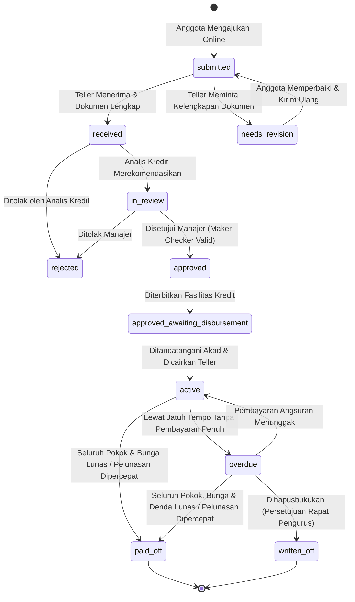
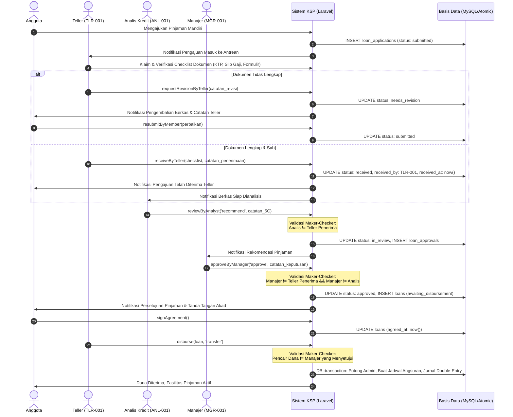
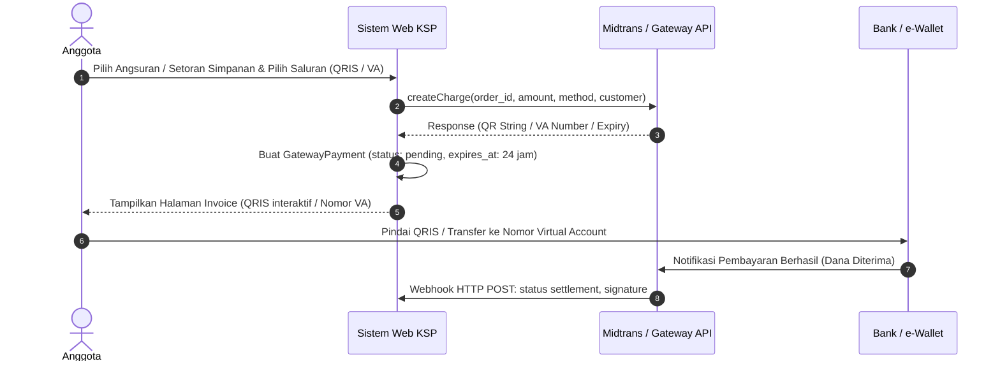

# Dokumentasi Alur Sistem Informasi KSP Sahabat Sejahtera

Dokumen ini menjelaskan alur operasional, peran pengguna, aturan bisnis, dan tata kelola transaksi pada Sistem Informasi Manajemen Koperasi Simpan Pinjam online (KSP Sahabat Sejahtera), dirancang agar mudah dipahami oleh Pengurus, Pengawas, Pengelola, maupun Tim IT.

---

## 1. Peran dan Tanggung Jawab Pengguna

| Peran | Kode Sistem | Tanggung Jawab Utama |
|---|---|---|
| **Anggota** | `member` | Melakukan pendaftaran mandiri, mengunggah dokumen KYC (KTP, Swafoto, Bukti Penghasilan), menyetor simpanan (pokok, wajib, sukarela), melakukan simulasi pinjaman, mengajukan pinjaman online, menandatangani akad digital, membayar angsuran, serta menerima pembagian SHU. |
| **Teller / Petugas Kas** | `teller` | Melakukan verifikasi fisik/data calon anggota, menerima setoran simpanan pokok untuk aktivasi anggota, memproses setoran dan penarikan kas simpanan sukarela, mencairkan dana pinjaman yang telah disetujui, dan menerima/memverifikasi pembayaran angsuran. |
| **Analis Kredit** | `analyst` | Melakukan analisis kelayakan permohonan pinjaman (5C: Character, Capacity, Capital, Collateral, Condition), memeriksa likuiditas simpanan pemohon, dan memberikan rekomendasi (setuju/tolak) beserta catatan mitigasi risiko. |
| **Manajer** | `manager` | Memberikan keputusan akhir persetujuan/penolakan pinjaman berjenjang berdasarkan rekomendasi analis, memantau portofolio pinjaman, rasio kredit bermasalah (NPL), dan menyetujui tutup buku/SHU tahunan. |
| **Admin / Pengurus** | `admin` | Mengelola data master (Bagan Akun/CoA, Produk Pinjaman, Kebijakan Simpanan), memantau jurnal akuntansi otomatis, memantau buku besar dan neraca saldo, mengeksekusi tutup buku akhir periode, dan melihat jejak audit (*audit logs*). |

---

## 2. Prinsip Integritas dan Perlindungan Anggota

Sistem ini dibangun berlandaskan nilai-nilai jati diri koperasi dan prinsip perlindungan konsumen keuangan:
1. **Integritas Moneter Integer**: Seluruh nilai uang disimpan dalam satuan Rupiah bulat (`BIGINT` / `INTEGER`), tanpa pembulatan desimal mengambang (*floating point*), menjamin akurasi mutlak hingga Rp 1.
2. **Double-Entry & Immutability**: Setiap mutasi keuangan menghasilkan jurnal akuntansi otomatis berpasangan dengan total Debit sama dengan total Kredit. Catatan keuangan bersifat *append-only* (tidak dapat diedit atau dihapus). Koreksi kesalahan dilakukan melalui mekanisme jurnal pembalik (*reversing entry*).
3. **Transparansi Tanpa Biaya Tersembunyi**: Anggota dapat melihat simulasi lengkap sebelum mengajukan pinjaman (jadwal angsuran bulanan, porsi pokok, porsi bunga, biaya administrasi, dan total kewajiban).
4. **Bebas dari Praktik Penagihan Predatori**: Sistem tidak memiliki akses ke buku kontak, galeri, atau data perangkat pengguna. Pengingat jatuh tempo dikirimkan secara santun dan profesional melalui notifikasi sistem internal.

---

## 3. Alur Pendaftaran & Verifikasi Anggota

```mermaid
flowchart TD
    A([Calon Anggota Mendaftar Online]) --> B[Mengisi NIK, Biodata Diri, Pekerjaan, dan Kontak]
    B --> C[Mengunggah Dokumen KYC: KTP, Swafoto, & Bukti Penghasilan]
    C --> D[Status Anggota: PENDING]
    D --> E{Teller Memeriksa Berkas KYC}
    E -- Ditolak / Tidak Valid --> E1[Status Ditolak / Meminta Perbaikan Dokumen] --> B
    E -- Terverifikasi Sah --> F[Status Anggota: VERIFIED]
    F --> G[Calon Anggota Menyetor Simpanan Pokok Rp 100.000 ke Teller/Bank]
    G --> H[Teller Mencatat Setoran Simpanan Pokok]
    H --> I[[Sistem Menjurnal Otomatis:<br/>Debit: Kas Koperasi (1101)<br/>Kredit: Simpanan Pokok (2101)]]
    I --> J[Status Anggota: ACTIVE]
    J --> K([Anggota Berhak Menabung & Mengajukan Pinjaman])
```

### State Diagram Keanggotaan


---

## 4. Alur Simpanan Koperasi (Pokok, Wajib, Sukarela)

```mermaid
flowchart TD
    A([Anggota Aktif]) --> B{Pilih Jenis Transaksi}
    
    B -- Setor Simpanan Wajib Bulanan --> C[Teller Memproses Setoran Simpanan Wajib]
    C --> C1[[Jurnal Otomatis:<br/>Debit: Kas/Bank (1101/1102)<br/>Kredit: Simpanan Wajib (2102)]]
    C1 --> C2[Saldo Simpanan Wajib Bertambah]
    
    B -- Setor Simpanan Sukarela --> D[Anggota / Teller Menginput Nominal Setoran]
    D --> D1[[Jurnal Otomatis:<br/>Debit: Kas/Bank (1101/1102)<br/>Kredit: Simpanan Sukarela (2103)]]
    D1 --> D2[Saldo Simpanan Sukarela Bertambah]
    
    B -- Penarikan Simpanan Sukarela --> E[Anggota Mengajukan Penarikan Dana]
    E --> E1{Cek Saldo Mencukupi?}
    E1 -- Tidak --> E2[Transaksi Ditolak: Saldo Tidak Cukup]
    E1 -- Ya --> E3[Teller Menyerahkan Uang Tunai / Transfer]
    E3 --> E4[[Jurnal Otomatis:<br/>Debit: Simpanan Sukarela (2103)<br/>Kredit: Kas/Bank (1101/1102)]]
    E4 --> E5[Saldo Simpanan Sukarela Berkurang]
```

---

## 5. Alur Pengajuan, Verifikasi Teller, Analisis Kredit, dan Pencairan Pinjaman



### State Diagram Siklus Pengajuan & Pinjaman


### Sequence Diagram Penerimaan Teller & Maker-Checker


---

## 6. Alur Pembayaran Angsuran & Penanganan Keterlambatan

```mermaid
flowchart TD
    A([Jadwal Angsuran Jatuh Tempo]) --> B{Anggota Membayar Tepat Waktu?}
    
    B -- Ya --> C[Anggota Membayar via Kasir Teller / Transfer]
    C --> D[[Waterfall Pelunasan Angsuran:<br/>1. Alokasi Pokok Angsuran<br/>2. Alokasi Bunga Angsuran<br/>3. Lebihan Dana masuk ke Simpanan Sukarela]]
    D --> E[[Jurnal Otomatis:<br/>Debit: Kas/Bank (1101/1102)<br/>Kredit: Piutang Pinjaman (1201)<br/>Kredit: Pendapatan Bunga (4101)]]
    E --> F[Status Jadwal: PAID]
    F --> G{Semua Angsuran Lunas?}
    G -- Ya --> H[Status Pinjaman: PAID_OFF (LUNAS)]
    G -- Belum --> I[Status Pinjaman: ACTIVE]
    
    B -- Tidak (Terlambat) --> J[[Scheduler Harian 00:05 WIB:<br/>1. Tandai Jadwal: OVERDUE<br/>2. Tandai Pinjaman: OVERDUE<br/>3. Hitung Denda Harian: Pokok x Tarif x Hari Terlambat<br/>4. Catat ke Tabel Penalties]]
    J --> K[Notifikasi Pengingat Santun & Kekeluargaan dikirim ke Anggota]
    K --> L[Anggota Datang Membayar Tunggakan]
    L --> M[[Waterfall Pembayaran Menunggak:<br/>1. Lunasi Denda Terlebih Dahulu<br/>2. Lunasi Bunga Pinjaman<br/>3. Lunasi Sisa Pokok]]
    M --> N[[Jurnal Otomatis Pembayaran Denda:<br/>Debit: Kas/Bank (1101)<br/>Kredit: Pendapatan Denda (4103)<br/>Kredit: Pendapatan Bunga (4101)<br/>Kredit: Piutang Pinjaman (1201)]]
    N --> O[Status Pinjaman Kembali Menjadi ACTIVE / PAID_OFF]
```

### Alur Pelunasan Dipercepat (*Early Repayment*)
```mermaid
flowchart TD
    ER1([Anggota Memilih 'Pelunasan Dipercepat']) --> ER2[Sistem Menghitung Total Pelunasan:<br/>Sisa Pokok Beredar + Denda Tertunggak]
    ER2 --> ER3[[Pembebasan Bunga Masa Depan:<br/>Seluruh sisa bunga periode belum jatuh tempo dibebaskan 100%]]
    ER3 --> ER4[Anggota / Petugas Mengonfirmasi Pembayaran Pelunasan]
    ER4 --> ER5[[Eksekusi Transaksi Atomik:<br/>1. Lunasi seluruh sisa jadwal angsuran (PAID)<br/>2. Update status pinjaman menjadi PAID_OFF (LUNAS)<br/>3. Catat Jurnal Double-Entry:<br/>Debit: Kas/Bank (1101/1102)<br/>Kredit: Piutang Pinjaman Anggota (1201)<br/>Kredit: Pendapatan Denda (jika ada)<br/>4. Catat Audit Log Pelunasan Dipercepat]]
    ER5 --> ER6([Fasilitas Pinjaman Resmi Ditutup / Lunas])
```

---

## 7. Alur Tutup Buku & Pembagian Sisa Hasil Usaha (SHU)

```mermaid
flowchart TD
    A([Akhir Periode Tahun Buku - 31 Desember]) --> B[Admin / Manajer Membuka Modul SHU]
    B --> C[[Sistem Menghitung Otomatis dari Jurnal:<br/>Total Pendapatan (Akun 4xxx) - Total Beban (Akun 5xxx) = Net SHU]]
    C --> D[[Alokasi Standar AD/ART:<br/>1. Dana Cadangan: 40% (Penguatan Modal)<br/>2. Jasa Modal / Simpanan: 25%<br/>3. Jasa Usaha / Pinjaman: 20%<br/>4. Dana Pengurus & Pengawas: 5%<br/>5. Dana Pendidikan Koperasi: 5%<br/>6. Dana Sosial: 5%]]
    D --> E[Sistem Menghitung Bagian Masing-Masing Anggota Aktif]
    E --> F[Admin Mengeksekusi 'Tutup Buku & Bagikan SHU']
    F --> G[[Eksekusi Transaksi Atomik:<br/>1. Kunci Periode Tahun Buku menjadi CLOSED<br/>2. Salurkan Bagian SHU Anggota ke Rekening Simpanan Sukarela<br/>3. Catat Jurnal Penutup Akuntansi Otomatis:<br/>Debit: Ikhtisar Laba Rugi / Pendapatan<br/>Kredit: Beban Operasional<br/>Kredit: Simpanan Sukarela Anggota (2103)<br/>Kredit: Dana Cadangan Koperasi (3201)]]
    G --> H([Anggota Dapat Langsung Menarik atau Mengendapkan SHU])
```

---

## 8. Alur Payment Gateway, Webhook Idempotensi & Rekonsiliasi Bank (Fase 3)

### Diagram Alur Checkout & Pembayaran Gateway


### Diagram Alur Pemrosesan Webhook Otomatis & Idempotensi
```mermaid
flowchart TD
    WH1([Webhook Masuk dari Gateway]) --> WH2{Verifikasi Signature Valid?}
    WH2 -- Tidak Valid --> WH2Err[Tolak HTTP 400 Bad Request]
    WH2 -- Valid --> WH3{Cek Idempotensi Event Mentah?}
    WH3 -- Pernah Diproses Sebelumnya --> WH3Dup[Abaikan & Balas HTTP 200 OK Idempotent]
    WH3 -- Event Baru --> WH4[[Kunci Baris Basis Data: DB::transaction + lockForUpdate]]
    
    WH4 --> WH5{Status Gateway?}
    WH5 -- Expire / Cancel / Deny --> WH5A[Update Status GatewayPayment: expired / failed]
    WH5 -- Settlement / Paid --> WH6[[Eksekusi Alokasi Finansial Waterfall]]
    
    WH6 --> WH7[[Urutan Waterfall:<br/>1. Lunasi Denda Tertunggak<br/>2. Lunasi Bunga Pinjaman<br/>3. Lunasi Pokok Pinjaman<br/>4. Lebihan Dana masuk ke Simpanan Sukarela (Cr 2103)]]
    WH7 --> WH8[[Catat Jurnal Pembayaran Gateway Otomatis:<br/>Debit: Dana dalam Penyelesaian Gateway (1301)<br/>Kredit: Piutang Pinjaman Anggota (1201)<br/>Kredit: Pendapatan Bunga (4101)<br/>Kredit: Pendapatan Denda (4103)<br/>Kredit: Simpanan Sukarela (2103 jika ada lebih bayar)]]
    WH8 --> WH9[Update Status GatewayPayment: PAID]
    WH9 --> WH10[Kirim Notifikasi Real-Time ke Anggota & Terbitkan Kuitansi Resmi]
```

### Diagram Alur Rekonsiliasi Settlement ke Bank Koperasi
```mermaid
flowchart LR
    S1[Transaksi Paid Terkumpul di Akun 1301 Kliring] --> S2[Manajer/Admin Memilih Batch Transaksi untuk Dicairkan]
    S2 --> S3[[Sistem Menghitung:<br/>Total Bruto (Cr 1301)<br/>Total Biaya Fee (Dr 5103)<br/>Neto Masuk Bank (Dr 1102)]]
    S3 --> S4[[Catat Jurnal Settlement Otomatis:<br/>Debit: Bank Koperasi 1102 (Neto)<br/>Debit: Biaya Gateway 5103 (Fee MDR)<br/>Kredit: Dana Penyelesaian 1301 (Bruto)]]
    S4 --> S5([Saldo Kas Bank Sinkron dengan Mutasi Rekening Koran])
```

