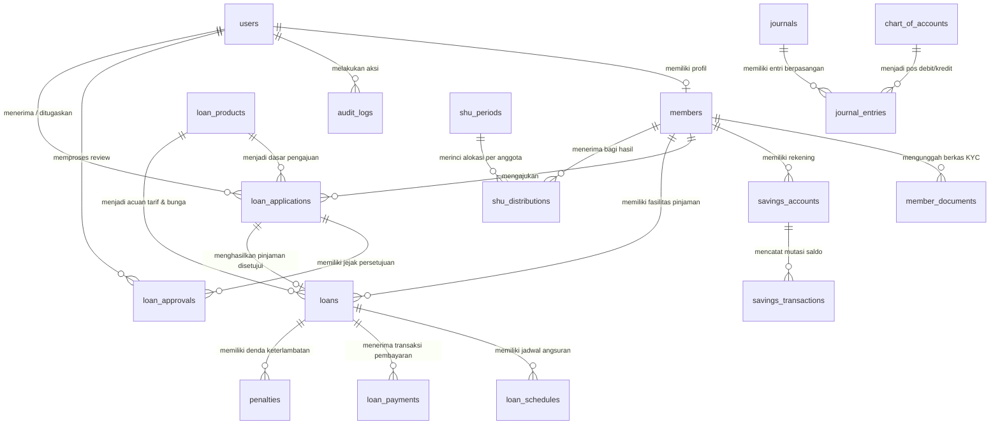

# Desain Basis Data & Skema Koperasi KSP Sahabat Sejahtera

Dokumen ini memuat arsitektur basis data, Entity Relationship Diagram (ERD), daftar tabel, tipe data, indeks, serta mekanisme integritas finansial pada database `ksp_koperasi`.

---

## 1. Diagram Hubungan Entitas (ERD)

---

## 2. Rincian Entitas & Struktur Tabel

### A. Pengguna & Keanggotaan
1. **`users`**: Akun autentikasi untuk login ke sistem web.
   - `id` (BIGINT, PK)
   - `name` (VARCHAR 255)
   - `email` (VARCHAR 255, UNIQUE)
   - `phone` (VARCHAR 25, NULLABLE)
   - `role` (ENUM: `admin`, `manager`, `analyst`, `teller`, `member`)
   - `employee_code` (VARCHAR 30, UNIQUE, NULLABLE, contoh: `TLR-001`, `ANL-001`)
   - `is_active` (BOOLEAN, DEFAULT true)
   - `password` (VARCHAR 255)
   - `timestamps`

2. **`members`**: Profil anggota resmi koperasi dan data kepatuhan KYC.
   - `id` (BIGINT, PK)
   - `user_id` (BIGINT, FK ke users, UNIQUE)
   - `member_no` (VARCHAR 30, UNIQUE, contoh: `KSP-202610-0001`)
   - `nik` (VARCHAR 20, UNIQUE)
   - `birth_date` (DATE)
   - `birth_place` (VARCHAR 100)
   - `gender` (ENUM: `L`, `P`)
   - `address` (TEXT)
   - `occupation` (VARCHAR 100)
   - `monthly_income` (BIGINT)
   - `bank_name` (VARCHAR 50, NULLABLE)
   - `bank_account` (VARCHAR 50, NULLABLE)
   - `status` (ENUM: `pending`, `verified`, `active`, `suspended`, `resigned`)
   - `verified_at` (TIMESTAMP, NULLABLE)
   - `verified_by` (BIGINT, FK ke users, NULLABLE)
   - `activated_at` (TIMESTAMP, NULLABLE)
   - `activated_by` (BIGINT, FK ke users, NULLABLE)
   - `timestamps`

3. **`member_documents`**: Arsip berkas identitas anggota.
   - `id` (BIGINT, PK)
   - `member_id` (BIGINT, FK ke members)
   - `type` (ENUM: `ktp`, `selfie`, `salary_slip`, `other`)
   - `file_path` (VARCHAR 255)
   - `original_name` (VARCHAR 255)
   - `is_verified` (BOOLEAN, DEFAULT false)
   - `verified_at` (TIMESTAMP, NULLABLE)
   - `notes` (TEXT, NULLABLE)
   - `timestamps`

### B. Modul Simpanan
4. **`savings_accounts`**: Rekening simpanan anggota per jenis.
   - `id` (BIGINT, PK)
   - `member_id` (BIGINT, FK ke members)
   - `account_no` (VARCHAR 35, UNIQUE, contoh: `SAV-POK-202610-0001`)
   - `type` (ENUM: `pokok`, `wajib`, `sukarela`)
   - `balance` (BIGINT, DEFAULT 0, nilai dalam Rupiah bulat)
   - `status` (ENUM: `active`, `blocked`, `closed`)
   - `timestamps`

5. **`savings_transactions`**: Buku mutasi transaksi setoran & penarikan simpanan.
   - `id` (BIGINT, PK)
   - `savings_account_id` (BIGINT, FK ke savings_accounts)
   - `transaction_no` (VARCHAR 35, UNIQUE)
   - `type` (ENUM: `deposit`, `withdrawal`)
   - `amount` (BIGINT, nilai transaksi dalam Rupiah)
   - `balance_before` (BIGINT)
   - `balance_after` (BIGINT)
   - `payment_method` (ENUM: `cash`, `transfer`)
   - `status` (ENUM: `pending`, `success`, `rejected`)
   - `notes` (TEXT, NULLABLE)
   - `created_by` (BIGINT, FK ke users)
   - `timestamps`

### C. Modul Pinjaman & Pembiayaan
6. **`loan_products`**: Katalog produk pembiayaan yang ditawarkan koperasi.
   - `id` (BIGINT, PK)
   - `code` (VARCHAR 20, UNIQUE)
   - `name` (VARCHAR 100)
   - `description` (TEXT, NULLABLE)
   - `interest_rate_annual` (DECIMAL 5,2)
   - `interest_rate_monthly` (DECIMAL 5,2)
   - `interest_rate_per_period` (DECIMAL 5,2, suku bunga per periode minggu/bulan)
   - `calculation_method` (ENUM: `flat`, `effective`, `annuity`)
   - `tenor_unit` (VARCHAR 10: `month`, `week`)
   - `min_amount` (BIGINT)
   - `max_amount` (BIGINT)
   - `min_tenor_months` (INT)
   - `max_tenor_months` (INT)
   - `min_tenor` (INT, batas tenor minimum sesuai satuan)
   - `max_tenor` (INT, batas tenor maksimum sesuai satuan)
   - `admin_fee_percentage` (DECIMAL 5,2)
   - `admin_fee_fixed` (BIGINT)
   - `penalty_rate_daily` (DECIMAL 5,4)
   - `is_active` (BOOLEAN, DEFAULT true)
   - `timestamps`

7. **`loan_applications`**: Berkas pengajuan pinjaman online dari anggota dan penanganan verifikasi teller.
   - `id` (BIGINT, PK)
   - `member_id` (BIGINT, FK ke members)
   - `loan_product_id` (BIGINT, FK ke loan_products)
   - `application_no` (VARCHAR 35, UNIQUE)
   - `amount` (BIGINT, nominal pinjaman bulat)
   - `tenor_unit` (VARCHAR 10: `month`, `week`)
   - `tenor_months` (INT, jangka waktu bulan)
   - `tenor_count` (INT, jumlah periode tenor mingguan atau bulanan)
   - `purpose` (TEXT, tujuan penggunaan dana)
   - `calculation_method` (ENUM: `flat`, `effective`, `annuity`)
   - `interest_rate_monthly` (DECIMAL 5,2)
   - `interest_rate_per_period` (DECIMAL 5,2)
   - `admin_fee` (BIGINT)
   - `monthly_installment_estimate` (BIGINT)
   - `status` (ENUM: `draft`, `submitted`, `received`, `needs_revision`, `in_review`, `approved`, `rejected`, `cancelled`)
   - `assigned_to` (BIGINT, FK ke users, NULLABLE - teller yang ditugaskan/klaim)
   - `assigned_by` (BIGINT, FK ke users, NULLABLE - admin/manajer yang mengalihkan)
   - `assigned_at` (TIMESTAMP, NULLABLE)
   - `assignment_notes` (TEXT, NULLABLE - alasan pengalihan)
   - `received_by` (BIGINT, FK ke users, NULLABLE - teller yang memvalidasi)
   - `received_at` (TIMESTAMP, NULLABLE)
   - `reception_checklist` (JSON, NULLABLE - rincian dokumen KTP, formulir, slip gaji, dsb.)
   - `reception_note` (TEXT, NULLABLE - catatan verifikasi penerimaan)
   - `reception_status` (VARCHAR 30, NULLABLE - `complete`, `needs_revision`)
   - `revision_requested_at` (TIMESTAMP, NULLABLE)
   - `revision_notes` (TEXT, NULLABLE - catatan kekurangan berkas untuk anggota)
   - `submitted_at` (TIMESTAMP)
   - `timestamps`

8. **`loan_approvals`**: Catatan riwayat review berjenjang (analis dan manajer).
   - `id` (BIGINT, PK)
   - `loan_application_id` (BIGINT, FK ke loan_applications)
   - `user_id` (BIGINT, FK ke users)
   - `role` (VARCHAR 20, contoh: `analyst`, `manager`)
   - `status` (VARCHAR 20, contoh: `recommended`, `approved`, `rejected`)
   - `notes` (TEXT, catatan analisis kredit)
   - `recommendations` (TEXT, NULLABLE)
   - `timestamps`

9. **`loans`**: Rekening fasilitas pinjaman aktif yang telah disetujui.
   - `id` (BIGINT, PK)
   - `loan_application_id` (BIGINT, FK ke loan_applications, NULLABLE)
   - `member_id` (BIGINT, FK ke members)
   - `loan_product_id` (BIGINT, FK ke loan_products)
   - `loan_no` (VARCHAR 35, UNIQUE)
   - `principal_amount` (BIGINT, plafon pokok awal)
   - `total_interest` (BIGINT, total kewajiban bunga)
   - `total_admin_fee` (BIGINT, biaya administrasi dipotong di awal)
   - `total_loan_amount` (BIGINT)
   - `outstanding_principal` (BIGINT, sisa pokok beredar)
   - `outstanding_interest` (BIGINT, sisa bunga beredar)
   - `outstanding_penalty` (BIGINT, sisa denda menunggak)
   - `tenor_unit` (VARCHAR 10: `month`, `week`)
   - `tenor_months` (INT)
   - `tenor_count` (INT, jumlah periode tenor)
   - `interest_rate_monthly` (DECIMAL 5,2)
   - `interest_rate_per_period` (DECIMAL 5,2)
   - `calculation_method` (ENUM: `flat`, `effective`, `annuity`)
   - `status` (ENUM: `approved_awaiting_disbursement`, `active`, `overdue`, `paid_off`, `written_off`)
   - `agreed_at` (TIMESTAMP, tanda tangan akad anggota)
   - `disbursed_at` (TIMESTAMP, waktu pencairan dana)
   - `disbursed_by` (BIGINT, FK ke users, teller yang mencairkan)
   - `maturity_date` (DATE)
   - `timestamps`

10. **`loan_schedules`**: Jadwal angsuran per bulan otomatis.
    - `id` (BIGINT, PK)
    - `loan_id` (BIGINT, FK ke loans)
    - `installment_no` (INT, 1 s/d tenor)
    - `due_date` (DATE, tanggal jatuh tempo bulanan)
    - `principal_amount` (BIGINT, porsi pokok angsuran)
    - `interest_amount` (BIGINT, porsi bunga angsuran)
    - `total_amount` (BIGINT, total angsuran bulanan)
    - `paid_principal` (BIGINT, DEFAULT 0)
    - `paid_interest` (BIGINT, DEFAULT 0)
    - `paid_penalty` (BIGINT, DEFAULT 0)
    - `remaining_principal` (BIGINT)
    - `status` (ENUM: `unpaid`, `partial`, `paid`, `overdue`)
    - `paid_at` (TIMESTAMP, NULLABLE)
    - `days_overdue` (INT, DEFAULT 0)
    - `penalty_amount` (BIGINT, DEFAULT 0)
    - `timestamps`

11. **`loan_payments`**: Bukti setor pembayaran angsuran pinjaman.
    - `id` (BIGINT, PK)
    - `loan_id` (BIGINT, FK ke loans)
    - `payment_no` (VARCHAR 35, UNIQUE)
    - `payment_date` (DATE)
    - `amount` (BIGINT)
    - `principal_portion` (BIGINT)
    - `interest_portion` (BIGINT)
    - `penalty_portion` (BIGINT)
    - `payment_method` (ENUM: `cash`, `transfer`)
    - `proof_file` (VARCHAR 255, NULLABLE)
    - `status` (ENUM: `pending`, `verified`, `rejected`)
    - `verified_by` (BIGINT, FK ke users)
    - `verified_at` (TIMESTAMP)
    - `notes` (TEXT, NULLABLE)
    - `timestamps`

12. **`penalties`**: Log perhitungan denda keterlambatan harian.
    - `id` (BIGINT, PK)
    - `loan_id` (BIGINT, FK ke loans)
    - `loan_schedule_id` (BIGINT, FK ke loan_schedules)
    - `calculated_date` (DATE)
    - `days_overdue` (INT)
    - `daily_rate` (DECIMAL 6,4)
    - `amount` (BIGINT)
    - `is_settled` (BOOLEAN, DEFAULT false)
    - `settled_at` (TIMESTAMP, NULLABLE)
    - `timestamps`

### D. Akuntansi Double-Entry & Tutup Buku
13. **`chart_of_accounts`**: Bagan Akun Standar Koperasi Simpan Pinjam.
    - `id` (BIGINT, PK)
    - `code` (VARCHAR 10, UNIQUE, contoh: `1101`, `1201`, `2101`, `4101`)
    - `name` (VARCHAR 100)
    - `type` (ENUM: `asset`, `liability`, `equity`, `revenue`, `expense`)
    - `category` (VARCHAR 50)
    - `normal_balance` (ENUM: `debit`, `credit`)
    - `is_active` (BOOLEAN, DEFAULT true)
    - `timestamps`

14. **`journals`**: Header jurnal transaksi akuntansi umum.
    - `id` (BIGINT, PK)
    - `journal_no` (VARCHAR 35, UNIQUE, contoh: `JRN-20261027-0001`)
    - `date` (DATE)
    - `reference_type` (VARCHAR 50, contoh: `savings_transaction`, `loan_disbursement`)
    - `reference_id` (BIGINT, NULLABLE)
    - `description` (TEXT)
    - `total_amount` (BIGINT)
    - `status` (ENUM: `posted`, `reversed`)
    - `reversed_by_id` (BIGINT, FK ke users, NULLABLE)
    - `created_by` (BIGINT, FK ke users, NULLABLE)
    - `timestamps`

15. **`journal_entries`**: Baris debit dan kredit berpasangan (*double-entry lines*).
    - `id` (BIGINT, PK)
    - `journal_id` (BIGINT, FK ke journals, CASCADE)
    - `chart_of_account_id` (BIGINT, FK ke chart_of_accounts)
    - `type` (ENUM: `debit`, `credit`)
    - `amount` (BIGINT)
    - `memo` (VARCHAR 255, NULLABLE)
    - `timestamps`

16. **`shu_periods`**: Data penutupan buku tahunan dan akumulasi laba bersih.
    - `id` (BIGINT, PK)
    - `year` (INT, UNIQUE)
    - `total_income` (BIGINT)
    - `total_expense` (BIGINT)
    - `net_shu` (BIGINT)
    - `closed_at` (TIMESTAMP, NULLABLE)
    - `closed_by` (BIGINT, FK ke users, NULLABLE)
    - `status` (ENUM: `draft`, `closed`)
    - `timestamps`

17. **`shu_distributions`**: Rincian pembagian SHU kepada tiap anggota.
    - `id` (BIGINT, PK)
    - `shu_period_id` (BIGINT, FK ke shu_periods)
    - `member_id` (BIGINT, FK ke members)
    - `savings_share_amount` (BIGINT, SHU Jasa Simpanan)
    - `loan_interest_share_amount` (BIGINT, SHU Jasa Pinjaman)
    - `total_shu` (BIGINT)
    - `is_distributed` (BOOLEAN, DEFAULT false)
    - `distributed_at` (TIMESTAMP, NULLABLE)
    - `timestamps`

### E. Audit & Pengaturan
18. **`audit_logs`**: Rekam jejak audit keamanan seluruh perubahan sensitif.
    - `id` (BIGINT, PK)
    - `user_id` (BIGINT, FK ke users, NULLABLE)
    - `action` (VARCHAR 50)
    - `auditable_type` (VARCHAR 100)
    - `auditable_id` (BIGINT)
    - `old_values` (JSON, NULLABLE)
    - `new_values` (JSON, NULLABLE)
    - `ip_address` (VARCHAR 45, NULLABLE)
    - `user_agent` (VARCHAR 255, NULLABLE)
    - `created_at` (TIMESTAMP)

19. **`settings`**: Parameter operasional dan AD/ART yang dapat disesuaikan admin.
    - `id` (BIGINT, PK)
    - `key` (VARCHAR 50, UNIQUE)
    - `value` (TEXT)
    - `description` (TEXT, NULLABLE)
    - `timestamps`

20. **`notifications`**: Pengingat sistem santun internal untuk anggota.
    - `id` (BIGINT, PK)
    - `user_id` (BIGINT, FK ke users)
    - `title` (VARCHAR 150)
    - `message` (TEXT)
    - `type` (VARCHAR 50)
    - `is_read` (BOOLEAN, DEFAULT false)
    - `read_at` (TIMESTAMP, NULLABLE)
    - `timestamps`

### F. Payment Gateway & Rekonsiliasi Bank (Fase 3)
21. **`gateway_settlements`**: Batch penyelesaian kliring dana gateway ke rekening Bank Koperasi.
    - `id` (BIGINT, PK)
    - `settlement_no` (VARCHAR 40, UNIQUE, contoh: `STL-20261029-0001`)
    - `gateway` (VARCHAR 30, DEFAULT `fake`)
    - `total_transactions` (INTEGER)
    - `gross_amount` (BIGINT, Total dana bruto yang dicairkan dari 1301)
    - `fee_amount` (BIGINT, Total potongan MDR/biaya gateway ke 5103)
    - `net_amount` (BIGINT, Dana neto yang masuk ke rekening bank 1102)
    - `bank_account_code` (VARCHAR 20, DEFAULT `1102`)
    - `journal_id` (BIGINT, FK ke journals, NULLABLE)
    - `status` (ENUM: `pending`, `completed`, DEFAULT `completed`)
    - `settled_at` (TIMESTAMP, NULLABLE)
    - `created_by` (BIGINT, FK ke users, NULLABLE)
    - `notes` (TEXT, NULLABLE)
    - `timestamps`

22. **`gateway_payments`**: Tagihan / mutasi pembayaran digital melalui payment gateway.
    - `id` (BIGINT, PK)
    - `order_id` (VARCHAR 64, UNIQUE, contoh: `INV-LN-20261029-ABCDEF`)
    - `member_id` (BIGINT, FK ke members)
    - `transaction_type` (VARCHAR 30, `loan_installment` / `savings_deposit`)
    - `payable_type` & `payable_id` (Polymorphic: Loan / SavingsAccount)
    - `amount` (BIGINT, Pokok tagihan / setoran)
    - `fee_amount` (BIGINT, Biaya layanan gateway)
    - `fee_bearer` (VARCHAR 20, `cooperative` / `member`)
    - `gross_amount` (BIGINT, Total yang ditagihkan)
    - `principal_portion` (BIGINT, Alokasi ke pokok pinjaman)
    - `interest_portion` (BIGINT, Alokasi ke bunga pinjaman)
    - `penalty_portion` (BIGINT, Alokasi ke denda)
    - `overpayment_portion` (BIGINT, Alokasi kelebihan bayar ke simpanan sukarela)
    - `gateway` (VARCHAR 30, `fake`, `midtrans`, dll.)
    - `payment_method_type` (VARCHAR 40, `qris`, `va_bca`, `va_bni`, `va_bri`, `va_mandiri`, `gopay`, dll.)
    - `va_number` (VARCHAR 64, NULLABLE)
    - `qr_string` (TEXT, NULLABLE)
    - `qr_url` (VARCHAR 500, NULLABLE)
    - `payment_url` (VARCHAR 500, NULLABLE)
    - `status` (ENUM: `pending`, `paid`, `failed`, `expired`, `cancelled`, `refunded`, INDEX)
    - `expires_at` (TIMESTAMP)
    - `paid_at` (TIMESTAMP, NULLABLE)
    - `settled_at` (TIMESTAMP, NULLABLE)
    - `settlement_id` (BIGINT, FK ke gateway_settlements, NULLABLE)
    - `loan_payment_id` (BIGINT, FK ke loan_payments, NULLABLE)
    - `savings_transaction_id` (BIGINT, FK ke savings_transactions, NULLABLE)
    - `journal_id` (BIGINT, FK ke journals, NULLABLE)
    - `selected_schedule_ids` (JSON, NULLABLE)
    - `raw_payload` (JSON, NULLABLE)
    - `raw_response` (JSON, NULLABLE)
    - `notes` (TEXT, NULLABLE)
    - `timestamps`

23. **`payment_allocations`**: Audit alokasi spesifik per jadwal angsuran dari satu transaksi gateway.
    - `id` (BIGINT, PK)
    - `gateway_payment_id` (BIGINT, FK ke gateway_payments)
    - `loan_schedule_id` (BIGINT, FK ke loan_schedules)
    - `principal_allocated` (BIGINT)
    - `interest_allocated` (BIGINT)
    - `penalty_allocated` (BIGINT)
    - `total_allocated` (BIGINT)
    - `timestamps`

24. **`payment_webhook_events`**: Penyimpanan notifikasi mentah untuk verifikasi keabsahan & pencegahan duplikasi (idempotensi).
    - `id` (BIGINT, PK)
    - `gateway` (VARCHAR 30)
    - `event_id` (VARCHAR 120)
    - `order_id` (VARCHAR 64, INDEX)
    - `event_type` (VARCHAR 50)
    - `signature` (VARCHAR 255, NULLABLE)
    - `payload` (JSON)
    - `status` (ENUM: `received`, `processed`, `failed`, `ignored`)
    - `error_message` (TEXT, NULLABLE)
    - `processed_at` (TIMESTAMP, NULLABLE)
    - `timestamps`
    - **UNIQUE KEY**: `(gateway, event_id)`

---

## 3. Ketentuan Integritas Finansial

1. **Pencegahan Floating-Point Bug**: Kolom moneter (`balance`, `amount`, `total_amount`, `outstanding_*`) didefinisikan secara tegas sebagai `BIGINT`. Perhitungan bunga menggunakan floating sementara di level PHP namun dibulatkan ke bilangan bulat Rupiah (`(int) round(...)`) sebelum disimpan ke database.
2. **Pencatatan Berpasangan (Double-Entry Balance)**: `JournalService` memverifikasi bahwa total debit persis sama dengan total kredit. Jika terjadi selisih bahkan Rp 1, proses dibatalkan (`DB::rollBack()`) dan melempar `Exception`.
3. **Database Transaction Atomicity**: Setiap alur yang melibatkan lebih dari satu tabel (contoh: Pencairan Pinjaman yang mengubah status pinjaman, membuat 12 jadwal angsuran, memotong biaya admin, dan membuat 3 baris jurnal) selalu dibungkus dalam `DB::transaction(...)`.
4. **Immutability (Tanpa Edit / Hapus)**: Baris transaksi simpanan, pembayaran angsuran, dan jurnal yang berstatus `posted` tidak pernah dihapus. Koreksi dilakukan dengan membuat jurnal pembalik (*reversing entry*).
5. **Pencegahan Race Condition & Row-Level Locking (`lockForUpdate`)**: Pada proses kritis perbankan dan koperasi seperti klaim antrean teller (`claimByTeller`), penerimaan teller (`receiveByTeller`), dan persetujuan manajer, baris data dikunci secara pesimis dengan `DB::table('loan_applications')->where('id', ...)->lockForUpdate()` agar tidak terjadi duplikasi klaim atau tabrakan data bila dua staf memproses pada detik yang sama.
6. **Penegakan Maker-Checker (Segregation of Duties)**: Integritas operasional kredit ditegakkan di layer *service* (`LoanService`). Pengguna yang menerima berkas sebagai Teller dilarang menyetujui pinjaman (sebagai Manajer) untuk pengajuan yang sama; Analis yang merekomendasikan pinjaman dilarang memberikan keputusan persetujuan akhir; serta Manajer yang menyetujui dilarang melakukan pencairan dana (*disbursement*).
7. **Jejak Audit Kekal (*Audit Trail*) & Rekonstruksi Lini Masa**: Setiap transisi status pengajuan pinjaman (`submitted`, `received`, `needs_revision`, `in_review`, `approved`, `disbursed`) serta pengalihan penugasan dicatat ke tabel `audit_logs` secara otomatis bersama ID pelaku, nilai sebelum vs sesudah, IP address, dan timestamp. Data ini menjadi sumber kebenaran (*single source of truth*) dalam menyusun lini masa penanganan pinjaman (*loan timeline*).
